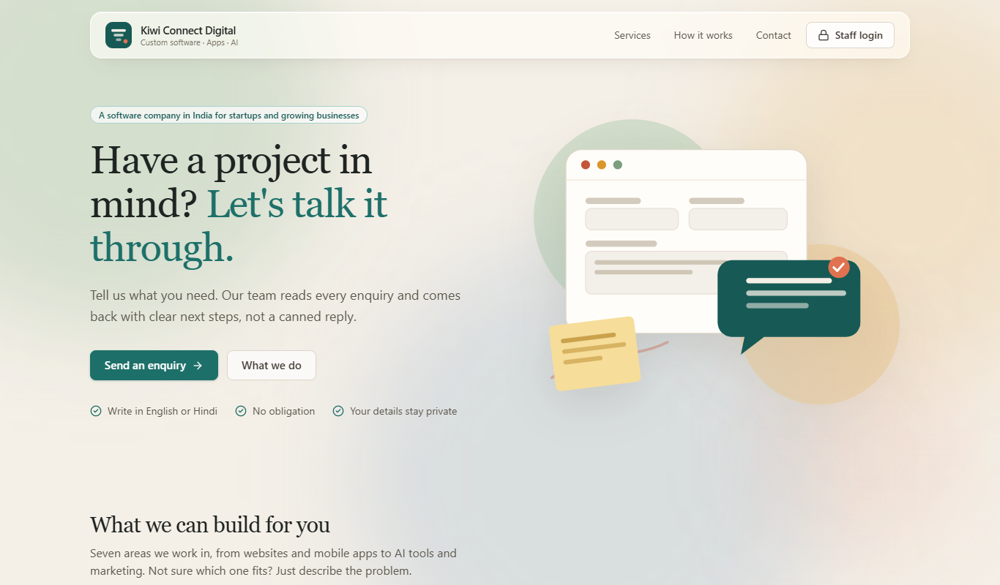
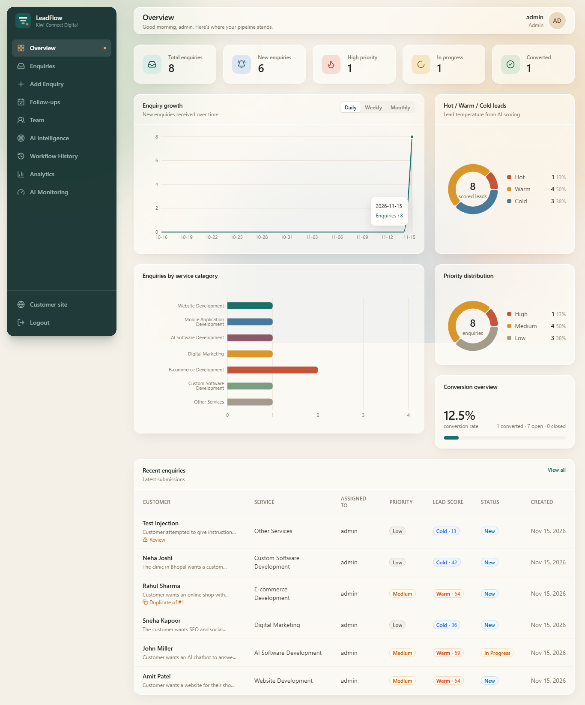
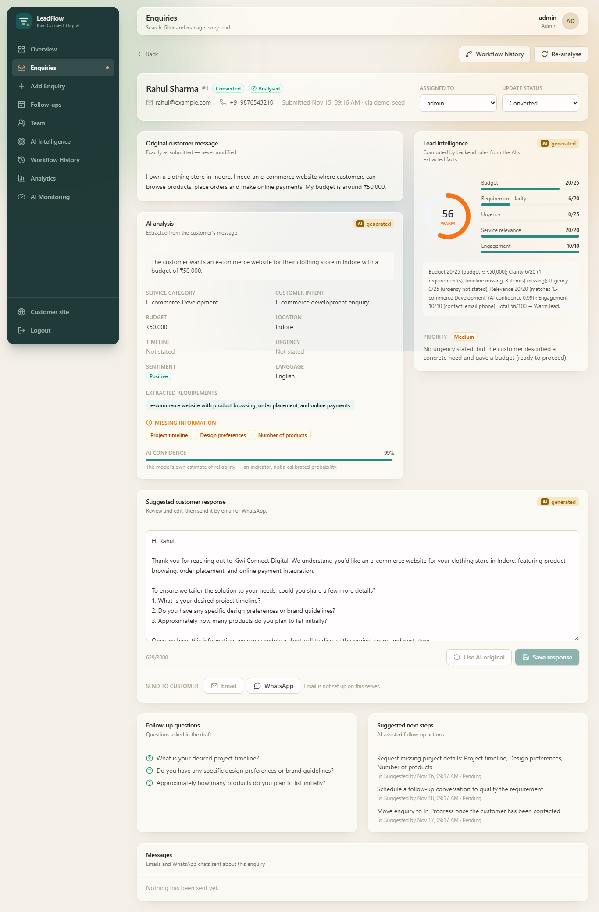

# LeadFlow AI

**An AI-powered workflow automation system for customer enquiries** — built for the Kiwi Connect Digital assignment.

A customer sends an enquiry. LeadFlow reads it with an LLM, extracts what matters (service, budget, location, urgency, requirements, what's missing), categorises and prioritises it, scores the lead, flags duplicates, assigns it to a team member, drafts a professional reply with follow-up questions, and stores everything. An admin console shows it all, and the admin reviews, edits and sends the reply.

> **The assignment's own example**, run through the live system:
> *"I own a clothing store in Indore. I need an e-commerce website where customers can browse products, place orders and make online payments. My budget is around ₹50,000."*
>
> | Extracted | Value |
> |---|---|
> | Category | **E-commerce Development** |
> | Budget | **₹50,000 (INR)** |
> | Location | **Indore** |
> | Requirements | e-commerce website with product browsing, order placement and online payments |
> | Missing information | Project timeline · Design preferences · Number of products |
> | Urgency / Priority | Not stated → **Medium** ("requirements are well defined and a budget was given") |
> | Lead | **Warm**, 56/100, with a written score breakdown |
> | Reply | Professional draft that acknowledges the need and asks the follow-up questions for the missing information |
>
> *(An LLM's wording varies slightly from run to run; the values above are from a real run of the final system. The structure and the key facts — category, ₹50,000, Indore — are stable.)*

Two panels in one app: a **public customer site** (`/`) and a **JWT-protected admin console** (`/admin`).

| Customer site | Admin dashboard |
|---|---|
|  |  |



<sub>More screenshots in [`docs/screenshots/`](docs/screenshots/): enquiries list, workflow timeline, follow-ups, team, analytics, AI monitoring. All data shown is fictional sample data.</sub>

---

## Quick start

**You need:** Python 3.11+ (tested on 3.11, 3.12, 3.14), Node.js 20.19+ (tested on 24), and a free API key from [Groq](https://console.groq.com/keys) and/or [Google AI Studio](https://aistudio.google.com/apikey). No paid service is required.

```bash
# 1 — backend
cd backend
python -m venv .venv
.venv\Scripts\activate                 # macOS/Linux:  source .venv/bin/activate
pip install -r requirements.txt

# 2 — configure (secrets live ONLY in backend/.env, which git ignores)
copy .env.example .env                 # macOS/Linux:  cp .env.example .env
#    then edit backend/.env:  GROQ_API_KEY=...  and/or  GEMINI_API_KEY=...
#    and set the first admin:  ADMIN_USERNAME / ADMIN_EMAIL / ADMIN_PASSWORD (it is created on first start)

uvicorn app.main:app --reload          # API on http://localhost:8000  (Swagger UI: /docs)

# 3 — frontend (new terminal)
cd frontend
npm install
copy .env.example .env                 # points at http://127.0.0.1:8000
npm run dev                            # http://localhost:5173
```

Open **http://localhost:5173/** (customer site) or **http://localhost:5173/admin/login** (admin console). Use `localhost`, not `127.0.0.1` — the backend's CORS list allows `localhost`.

Windows shortcut once set up: `powershell -ExecutionPolicy Bypass -File scripts\start-dev.ps1` starts both servers.

**Load demo data** (8 fictional enquiries, including Hindi, a duplicate and a prompt-injection attempt) through the real pipeline:

```bash
backend\.venv\Scripts\python scripts\seed_demo_data.py --statuses
```

**Run the tests** (no API key or network needed — the LLM is mocked, email goes to a local test SMTP server):

```bash
cd backend && python -m pytest -q        # 203 tests
cd frontend && npm run build             # type-check + production build
```

### Configuration highlights (`backend/.env`)

| Variable | Meaning |
|---|---|
| `GROQ_API_KEY`, `GEMINI_API_KEY` | At least one is needed for AI. With both set, the second is an automatic fallback |
| `AI_PRIMARY_PROVIDER` / `AI_FALLBACK_PROVIDER` | `groq` or `gemini`; switch providers by config, no code change |
| `GROQ_MODEL` / `GEMINI_MODEL` | Default `openai/gpt-oss-120b` / `gemini-2.5-flash` |
| `SMTP_*`, `NOTIFY_EMAIL` | Optional. Enables real email alerts and email replies. Without them these features are cleanly disabled, never faked |
| `JWT_SECRET` | Use a long random value (`ENVIRONMENT=production` refuses the default) |

The full list, with comments, is in [`backend/.env.example`](backend/.env.example).

---

## Assignment coverage

| Requirement | Where it is |
|---|---|
| **A. Enquiry input** (name, phone, email, message) | Public form on the customer site, and "Add Enquiry" in the admin console. Validated in the browser and again on the server |
| **B. AI analysis** (requirements, service, budget, location, urgency, missing info) | `backend/app/services/extraction_service.py` — LLM returns strict JSON, validated with Pydantic. Budget/location are discarded if the message doesn't support them |
| **C. Categorisation** (7 fixed categories) | Enforced as an enum: unsupported categories are rejected and retried; "Other Services" / low confidence → flagged for manual review |
| **D. AI reply** (professional, next steps, follow-up questions, editable) | `response_service.py`; editable on the enquiry page, original AI draft always preserved |
| **E. Admin dashboard** (all 6 stats + category chart; view details, analysis, reply; update status; search & filter) | `/admin` Overview, Enquiries, Enquiry detail |
| **F. Database** (enquiries, analysis, category, priority, status, retrieval) | SQLite via SQLAlchemy, 9 tables — see [`docs/DATABASE.md`](docs/DATABASE.md) |
| **Workflow steps 1–9** | `backend/app/services/workflow_service.py`; every step is logged and shown as a timeline — see [`docs/ARCHITECTURE.md`](docs/ARCHITECTURE.md) |
| **Priority Low / Medium / High** | Urgency comes from the AI; an explainable rule maps urgency + request completeness to a priority and stores the reason |

### Bonus features (all 10 implemented)

| # | Feature | Notes |
|---|---|---|
| 1 | Duplicate detection | Same email, same phone, or similar text → flagged for review, never merged |
| 2 | AI lead scoring | LLM extracts facts; a transparent 0–100 rule engine scores them with a written explanation (Hot / Warm / Cold) |
| 3 | Follow-up reminders | Suggested actions with due dates, an overdue badge, and a Follow-ups page to mark done / dismiss |
| 4 | WhatsApp | One-click `wa.me` chat with the reply pre-filled (no API key needed). Logged as *opened*, not *sent* — WhatsApp can't tell us |
| 5 | Email notifications | Real SMTP: alerts to the assignee/team and replies to customers. Needs `SMTP_*` in `.env` |
| 6 | Visual workflow | Step-by-step timeline per enquiry, with durations, errors and retry attempts |
| 7 | Analytics & reporting | Trends, funnel, conversion, lead/category/priority charts, pipeline estimate, AI usage and cost monitoring |
| 8 | Auto-assignment | Returning customer → same owner; else least-loaded; ties round-robin; team page with workload |
| 9 | Export | CSV and Excel (`.xlsx`), honouring the current filters |
| 10 | AI summaries | One-sentence summary per enquiry, shown on the detail page and in the list |

---

## Deploy (Render, free)

`render.yaml` + `Dockerfile` deploy the whole product as one service that uses your PostgreSQL connection string (it can safely share an existing database); step-by-step guide and free-tier caveats in [`docs/DEPLOY_RENDER.md`](docs/DEPLOY_RENDER.md). This exact setup was tested (real image, real PostgreSQL, real AI, browser end-to-end).

## How it works (short version)

```
Customer form ─▶ FastAPI ─▶ save original ─▶ auto-assign ─▶ (background) ─▶ duplicate check ─▶ LLM #1: extract
   ─▶ validate (Pydantic + grounding) ─▶ classify ─▶ priority ─▶ lead score ─▶ LLM #2: draft reply ─▶ follow-ups
   ─▶ ONE database transaction ─▶ email alert ─▶ available through the REST API ─▶ React admin console
```

Design choices worth knowing (details in [`docs/ARCHITECTURE.md`](docs/ARCHITECTURE.md) and [`docs/AI_MODEL.md`](docs/AI_MODEL.md)):

- **The LLM only extracts facts.** Priority, score, follow-ups and duplicate flags are computed by explainable backend rules, so a customer can't talk the system into a "Hot lead".
- **The original enquiry is saved first**, in its own commit. If the AI fails, nothing is lost; the admin sees the failure and presses *Retry*. Retries never create duplicate rows.
- **AI output is never trusted blindly:** strict schema, grounding checks, controlled retries, a fallback provider, and a manual-review flag.
- **Free-tier friendly:** a rate-limit-aware scheduler tracks tokens/requests per minute per provider and routes or queues instead of failing with HTTP 429.

## Tech stack

| Layer | Choice | Why |
|---|---|---|
| Backend | Python **FastAPI** | Async I/O for LLM calls, automatic Swagger docs, Pydantic validation built in |
| Database | **SQLite** locally, **PostgreSQL** when deployed (SQLAlchemy) | Zero setup for a local demo; the same models run on PostgreSQL, tested in the Docker image (`docs/schema.sql` has both dialects) |
| AI | **Groq** (`openai/gpt-oss-120b`) primary, **Google Gemini** (`gemini-2.5-flash`) fallback | Both have free tiers; a common provider interface makes them swappable |
| Frontend | **React + Vite + TypeScript + Tailwind CSS** | Fast, typed, component-based |
| Auth | JWT, PBKDF2 password hashing | Stateless; no extra service |

## Project structure

```
backend/        FastAPI app (routes → services → models), tests, sample data
  app/routes/     thin HTTP layer          app/services/   all business logic
  app/services/providers/   Groq + Gemini adapters behind one interface
frontend/       React admin console + public customer site
scripts/        seed_demo_data.py, start-dev.ps1, export_docs.py
docs/           architecture, database (ERD + SQL), AI model, deployment guide, OpenAPI spec
```

## Documentation

| Document | What's in it |
|---|---|
| [`docs/ARCHITECTURE.md`](docs/ARCHITECTURE.md) | System architecture, workflow, failure handling, scaling |
| [`docs/DATABASE.md`](docs/DATABASE.md) · [`docs/schema.sql`](docs/schema.sql) | ER diagram, table descriptions, full SQL schema (SQLite + PostgreSQL) |
| [`docs/AI_MODEL.md`](docs/AI_MODEL.md) | Which models, prompt design, validation, scoring rules, cost and limits |
| [`docs/DEPLOY_RENDER.md`](docs/DEPLOY_RENDER.md) | Deploying to Render, with the free-tier caveats |
| [`docs/openapi.json`](docs/openapi.json) · `/docs` | The REST API contract (also live in Swagger UI) |
| [`docs/SUBMISSION_CHECKLIST.md`](docs/SUBMISSION_CHECKLIST.md) | Every submission requirement and where it is satisfied |
| [`backend/README.md`](backend/README.md) · [`frontend/README.md`](frontend/README.md) | Component-level details and the API reference |

## Third-party libraries

**Backend (Python):** FastAPI, Uvicorn, SQLAlchemy, Pydantic, pydantic-settings, python-dotenv, email-validator, HTTPX (calls the LLM APIs), PyJWT, openpyxl (Excel export), pytest, aiosmtpd (a local mail server used only by the tests).
**Frontend (npm):** React, React Router, TanStack Query, Axios, React Hook Form, Zod, Recharts, Lucide icons, Sonner (toasts), Tailwind CSS, Vite, TypeScript, oxlint.
**External services:** Groq API and Google Gemini API (free tiers). No other paid or third-party service is used.

AI coding assistants (Claude) were used during development; the design decisions, the code and the trade-offs are explained in the documents above.

## Security

- API keys and passwords live only in `backend/.env` (git-ignored). Only `.env.example` files are committed.
- Passwords are hashed (PBKDF2-SHA256, random salt); JWTs expire; every admin endpoint is protected; the public endpoint is rate-limited.
- Customer text is treated as untrusted: delimited in the prompt, injection attempts are flagged, and the model's output can only be what the schema allows.
- Only the customer's message (and first name for the reply) is sent to the LLM — never email or phone.
- Spreadsheet exports neutralise formula injection. All sample data is fictional.

## Known limitations (honest list)

- **Free API tiers have rate limits.** The scheduler handles bursts gracefully, but a large burst takes minutes on the free tier. Failed analyses can be retried with one click.
- **Email needs your SMTP details** (e.g. a Gmail app password). It is tested against a real local SMTP server, but a live send needs your credentials.
- **WhatsApp is click-to-chat**, not the Business API (that needs an approved business account).
- **In-process background tasks** are right for a demo (and run fine on Render); see `docs/ARCHITECTURE.md` for the production path (a durable job queue).
- **Customers cannot track their own enquiry** — the backend has no public lookup endpoint.

## Troubleshooting

- **Blank page at localhost:5173** — Vite's dev cache can get corrupted: stop `npm run dev`, delete `frontend/node_modules/.vite`, start it again.
- **"AI failed" on an enquiry** — open it and press *Retry analysis*. Check the Workflow History page for the reason (usually a free-tier limit or a missing key).
- **Login fails** — use the `ADMIN_USERNAME` / `ADMIN_PASSWORD` from `backend/.env` (or from Render's Environment tab when deployed). The admin is created on first start, and its password is re-synced from `ADMIN_PASSWORD` on every start, so after changing the value, restart/redeploy.
