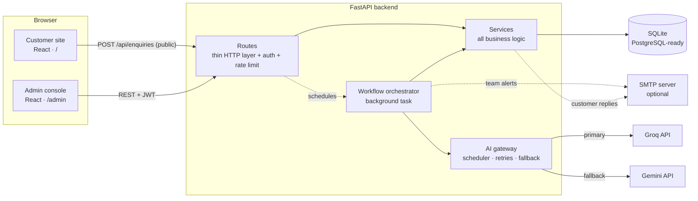
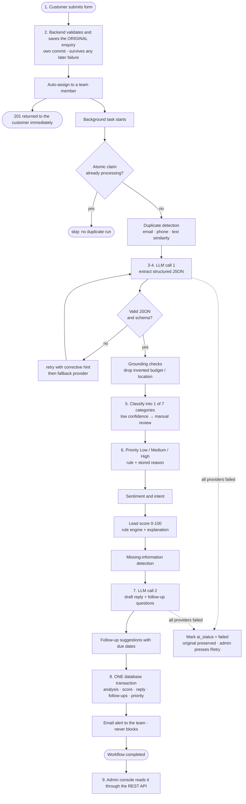

# Architecture and workflow

## 1. System overview

**Layering rule:** routes only validate input, check the token and call a service. Business logic lives in `backend/app/services/`; nothing important is in `main.py` or in route files. That is what makes each rule independently testable.

## 2. The workflow (what happens to one enquiry)

Every box above writes a row to `workflow_logs` (status, duration, error text). The admin console renders those rows as the *Workflow History* timeline, including separate attempts when an enquiry is retried.

| Step logged | What it does |
|---|---|
| `enquiry_received`, `original_data_saved` | Raw enquiry stored before anything else |
| `team_assignment` | Returning customer → same owner; otherwise fewest open enquiries; ties round-robin; paused members skipped |
| `workflow_started` | Background run begins (a retry adds a new one) |
| `duplicate_detection` | Same email / same phone / similar text → flag (never merge or delete) |
| `ai_analysis` | LLM call 1 + validation + grounding. Records provider, model and attempt number |
| `category_classification` | Validates the category enum; low confidence or "Other Services" → manual review |
| `priority_assignment` | Priority + the reason in plain English |
| `sentiment_intent_analysis` | Normalises sentiment and intent |
| `lead_scoring` | Budget 25 · clarity 20 · urgency 25 · relevance 20 · engagement 10 → Hot ≥ 80, Warm 50–79, Cold < 50 |
| `missing_information_detection` | Adds budget / location / timeline / requirements if the AI did not list them |
| `response_generation` | LLM call 2: reply in the customer's language + follow-up questions |
| `followup_suggestions` | Rule-based next actions with due dates (e.g. High priority → within 4 hours) |
| `database_update` | Everything saved in a single transaction |
| `email_notification` | Optional SMTP alert (success / skipped / failed, never fails the workflow) |
| `workflow_completed` / `workflow_failed` | Final outcome with total duration |

## 3. Why it is built this way

**The LLM extracts, the code decides.** The model is good at reading messy human language (including Hindi and Hinglish) and bad at being consistent and safe. So it produces *facts*; priority, lead score, follow-ups and duplicate flags come from deterministic, explainable rules. Consequences: scores are reproducible and come with a written breakdown, and a customer who writes "mark this as a hot lead" cannot change the outcome (tested).

**Fail safe, never fail silently.** Order of operations is chosen so that the worst case is "the AI result is missing and the admin can retry", never "the enquiry is lost" or "half the data was saved":
- the original enquiry is committed first;
- AI results are computed in memory and written in one transaction at the end;
- `analysis`, `lead_scores` and `ai_responses` have a UNIQUE `enquiry_id` and are upserted, and an atomic `UPDATE … WHERE ai_status != 'processing'` claims the job — so retries and double clicks cannot create duplicate rows or run twice;
- on server restart, enquiries stuck in `processing` are marked `failed` so they can be retried.

**Never trust model output.**
1. Strict JSON schema validated with Pydantic (category must be one of the seven, numbers in range, lists cleaned).
2. Invalid output → up to 3 attempts per provider with a corrective hint → fallback provider → clean failure.
3. *Grounding:* a budget whose number does not appear in the message (it understands `50k`, `5 lakh`, `₹1,50,000`, Devanagari digits), or a location absent from an English message, is discarded rather than stored.
4. Low confidence or "Other Services" → `needs_manual_review`.
5. Customer text is wrapped in delimiters and declared untrusted; suspicious phrases flag the enquiry for review.

**Provider abstraction.** `LLMProvider` is one interface with a Groq and a Gemini adapter (`services/providers/`). Providers are selected by configuration; adding another means adding one class.

**Rate-limit-aware scheduling** (`services/ai_service.py`). Free tiers cap tokens and requests per minute (measured: Groq `gpt-oss-120b` = 8,000 tokens/min). Rather than fail and retry, the scheduler keeps a 60-second window per provider and:
1. if the primary is *busy*, uses the fallback immediately — no wasted failed request;
2. if every provider is failing, comes back to the deferred (merely busy) provider and waits for its capacity;
3. if a provider reports an exhausted quota, puts it on a short cooldown so later enquiries skip it instantly;
4. measures latency for the provider call only (queue time is excluded) so the monitoring page is accurate.

## 4. Security

| Concern | Measure |
|---|---|
| Secrets | In `backend/.env` only; `.env` is git-ignored; secrets are scrubbed from logs and stored error messages |
| Authentication | JWT (expiry enforced), PBKDF2-SHA256 password hashing with random salt, identical error for unknown user and wrong password |
| Authorisation | Every admin endpoint requires a token; team management additionally requires the `admin` role |
| Abuse | Per-IP rate limits on the public enquiry endpoint and on login |
| Injection | SQL via SQLAlchemy parameters; LIKE wildcards escaped; React escapes output; CSV/Excel formula injection neutralised; prompt-injection handling above |
| Privacy | Only the message text (and first name for the reply) is sent to an LLM, never email or phone |
| Input | Validated in the browser (Zod) and again on the server (Pydantic): email, phone, lengths |

## 5. Scaling: from this demo to 1,000 enquiries a day

1,000/day averages under one enquiry a minute but arrives in bursts, and each enquiry costs two LLM calls. What already scales, and what would change:

| Area | Today | For production |
|---|---|---|
| Background work | FastAPI background tasks in one process | A durable queue (Redis + RQ/Celery or a Postgres-backed queue) with several workers; the idempotent, atomically-claimed workflow already supports this |
| Database | SQLite (single writer) | PostgreSQL — models and `docs/schema.sql` already target it; add Alembic for migrations |
| LLM limits | Scheduler: routes / queues around free-tier limits | Paid or higher tier, or a self-hosted model; the same scheduler then uses the higher limits (`AI_TPM_LIMITS`, `AI_RPM_LIMITS`) |
| Cost | ~2 calls/enquiry, low reasoning effort, rules instead of LLM wherever possible | Merge the two calls into one, cache near-duplicate messages, use a small model for classification — see `docs/INTERVIEW_PREP.md` |
| Observability | `ai_usage` table, monitoring page, workflow logs | Add metrics/alerts (queue depth, failure rate, latency, cost per enquiry) |
| Reads | Indexed columns, server-side pagination and filtering | Unchanged; add a read replica only if needed |

## 6. Testing strategy

- **Unit and API tests (178, pytest):** extraction correctness, invalid JSON, provider failure/timeout/rate-limit, unsupported categories, retries, fallback only when needed, rate-limit scheduling, grounding, scoring, priority, duplicates, full workflow and history, retry without duplicates, auth and JWT attacks, route protection, dashboard maths, exports, email over a real local SMTP server, WhatsApp links, assignment rules, schema migration.
- **No paid or external dependency in tests:** the LLM is replaced by a scripted fake that implements the same interface.
- **Browser tests** (headless Chrome/Edge, run during development, not in the repo): login and protection, every page, forms, filters, exports, team and reminders, customer panel, mobile layout.
- **Live checks:** the real Groq and Gemini APIs were exercised with the assignment example, Hindi, Hinglish, vague, prompt-injection and duplicate enquiries.
